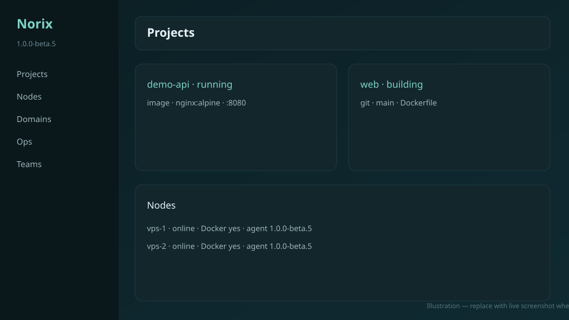

<h1 align="center">Norix</h1>

<p align="center">
  Open-source, self-hostable PaaS control plane.<br>
  Point it at a Git repo or container image — it builds, schedules, routes, and TLS-terminates your app.<br>
  Drive it from the web dashboard; agents + edge on your own VPS.
</p>

<p align="center">
  <a href="LICENSE"></a>
  <a href="https://github.com/xiron902224/norix"></a>
  <a href="docs/ESTADO_Y_PLAN_V1.md"></a>
  <a href="VERSION"></a>
</p>

<p align="center">
  <a href="#install">Install</a> ·
  <a href="docs/user/README.md">User guide</a> ·
  <a href="#how-it-works">How It Works</a> ·
  <a href="#interfaces">Interfaces</a> ·
  <a href="#features">Features</a> ·
  <a href="CONTRIBUTING.md">Contributing</a> ·
  <a href="#contributors">Contributors</a> ·
  <a href="README.es.md">Español</a>
</p>

<p align="center">
  
</p>

---

## Install

Norix runs on a Linux VPS you control. **One command** installs the control plane (OpenShip-style). Pick a mode:

| Mode | Command | Needs Docker? |
|---|---|---|
| **Docker** (default) | `… \| bash` | Yes — installs Engine if missing; panel + Postgres in Compose; this host can run workloads via `docker.sock` |
| **Bare** | `… \| bash -s -- --mode bare` | No — system Postgres + release binary (SHA256 verified) + systemd. Add Docker/agent later for container workloads |

Until `get.norix.dev` exists, the installer is served from this GitHub repo.

### Docker mode

```bash
curl -fsSL https://raw.githubusercontent.com/xiron902224/norix/v1.0.0-beta.5/scripts/get-norix.sh \
  | NORIX_REF=v1.0.0-beta.5 bash
```

### Bare mode (no Docker)

```bash
curl -fsSL https://raw.githubusercontent.com/xiron902224/norix/v1.0.0-beta.5/scripts/get-norix.sh \
  | NORIX_REF=v1.0.0-beta.5 bash -s -- --mode bare
```

Labs / containers without systemd:

```bash
curl -fsSL https://raw.githubusercontent.com/xiron902224/norix/v1.0.0-beta.5/scripts/get-norix.sh \
  | NORIX_REF=v1.0.0-beta.5 bash -s -- --mode bare --supervise none
```

Optional: `--port 8000`, `--public-url https://norix.example.com`. Re-runs are idempotent.

Full bare walkthrough (TLS, upgrades, manual fallback): [`docs/runbooks/BARE_INSTALL.md`](docs/runbooks/BARE_INSTALL.md).

Both modes print a URL like `http://YOUR_IP:8000`. Open it, create the first admin, then deploy.

```bash
curl -sf http://127.0.0.1:8000/healthz
```

Pin any branch/tag with `NORIX_REF=`. Integration tip (untagged tip): `main`.

### Add worker nodes

Create a join token under **Nodes**, then on each worker:

```bash
curl -fsSL https://raw.githubusercontent.com/xiron902224/norix/main/scripts/install-agent.sh \
  | bash -s -- --control-plane https://norix.example.com --token '…'
# auto: systemd on a real VPS; nohup in labs/containers without systemd
# (--supervise none|systemd, --no-start, --foreground also supported)
```

Workers need **Docker or containerd** for Git builds and containers (bare control plane alone is not enough).

<details>
<summary>Docker Compose without the curl installer</summary>

```bash
git clone https://github.com/xiron902224/norix.git && cd norix
git checkout v1.0.0-beta.5
cp deploy/norix/env.production.example .env   # set strong passwords
docker compose --env-file .env -f deploy/norix/docker-compose.prod.yml up -d --build
```

Panel: `http://SERVER_IP:8000`. The control-plane container mounts `/var/run/docker.sock` — use a trusted host. Back up `.env` off-box.

</details>

Local development (Postgres + `go run` + Vite) lives in [`CONTRIBUTING.md`](CONTRIBUTING.md#local-development).

---

## How It Works

Point Norix at a source — a **container image** or a **Git repo** — and it runs one loop end to end:

1. **Declare.** Create a project/workload in the dashboard (image, port, replicas, schedule strategy, optional git URL).
2. **Build (git).** An online node clones the repo, auto-detects a `Dockerfile` / `Containerfile` or `compose.yaml`, builds an image, and optionally pushes to a registry.
3. **Schedule.** The control plane places replicas across online, non-cordoned workers (spread / binpack, zones, KVM filter).
4. **Reconcile.** Agents (or the embedded local runtime) apply desired `run` / `stop` until observed state matches.
5. **Route + TLS.** Domains map through the Caddy edge; ACME for HTTPS when configured.
6. **Operate.** Heartbeats, metrics, backups, and alerts under Ops. Cordon/drain evacuates workloads before reschedule.

Deleting a workload marks it **deleting**, stops the container on the owning node, then purges the row — so Docker containers are not left behind.

---

## Interfaces

- **Web dashboard** — projects, workloads, nodes (cordon/drain/zones), domains, ops.
- **Connect RPC / protobuf API** — `proto/v1` shared by Go, TypeScript, and the Rust agent.
- **Rust agent** — enroll, heartbeat, build, reconcile, edge/mesh apply.
- **Embedded local runtime** — reconcile path inside the control plane when `docker.sock` is available (Docker install mode).

---

## Features

| | |
|---|---|
| **Git → image → deploy** | Dockerfile / Containerfile auto-detect, Compose build fallback, build logs in UI |
| **Image deploys** | Public images (e.g. `nginx:alpine`) with host port allocation |
| **Multi-replica scheduler** | Spread / binpack, zones, affinity hooks, require-KVM for micro-VMs |
| **Cordon / drain** | Block scheduling; ordered evacuate + reschedule orphans |
| **Domains & TLS** | Caddy edge + ACME path for HTTPS hostnames |
| **Ops** | Postgres backups, node metrics, `node.down` / `deploy.failed` alerts |
| **Tenancy** | Postgres RLS, sessions, RBAC (owner/admin/member) |
| **Identity** | OIDC + TOTP (optional) |
| **SDKs** | TypeScript, Python, Go |

---

## Deploy Anywhere

- Any Linux VPS or bare metal (amd64 / arm64)
- Multi-server: one control plane, agents on each worker ([3-node runbook](docs/runbooks/BETA1_3NODE_INSTALL.md))

---

## Status

**Beta** (`1.0.0-beta.5`). Living status: [`docs/ESTADO_Y_PLAN_V1.md`](docs/ESTADO_Y_PLAN_V1.md) · vision: [`VISION.md`](VISION.md) · backlog: [`ISSUES.md`](ISSUES.md).

**Spanish:** [`README.es.md`](README.es.md) · [`CONTRIBUTING.es.md`](CONTRIBUTING.es.md).

---

## Repository layout

| Path | Role |
|---|---|
| `control-plane/` | Go Connect server, migrations, scheduler, local runtime |
| `web/` | React + Vite dashboard (embedded in prod builds) |
| `agent/` | Rust node agent |
| `deploy/norix/` | Compose prod/dev stacks |
| `scripts/get-norix.sh` | Installer (`--mode docker\|bare`) |
| `scripts/install-agent.sh` | Worker join (systemd or nohup) |
| `docs/` | Plans and runbooks — start at [`docs/README.md`](docs/README.md) |
| `VISION.md` / `ISSUES.md` | Product vision + GitHub issue triage |
| `README.es.md` / `CONTRIBUTING.es.md` | Spanish collaborator docs |

---

## Contributing

**Gitflow:** pick an issue → branch from **`main`** → PR to **`main`** (`develop` is retired).

See **[`CONTRIBUTING.md`](CONTRIBUTING.md)** (EN) or **[`CONTRIBUTING.es.md`](CONTRIBUTING.es.md)** (ES). Local stack: Postgres + control-plane `:8080` + Vite `:5173` (+ optional agent). Doc map: [`docs/README.md`](docs/README.md). Pick work from [`ISSUES.md`](ISSUES.md) / [GitHub Issues](https://github.com/xiron902224/norix/issues).

---

## Contributors

Thanks to everyone shipping PRs and reviews:

<a href="https://github.com/xiron902224/norix/graphs/contributors">
  
</a>

| GitHub | Role |
|---|---|
| [@xiron902224](https://github.com/xiron902224) | Maintainer |
| [@Golden007-prog](https://github.com/Golden007-prog) | Collaborator |

To appear here: merge a PR to `main` (contributors graph) and/or accept a **Settings → Collaborators** invite (write access). Details: [`CONTRIBUTING.md`](CONTRIBUTING.md#collaborators--contributors-github).

---

## Security

Report vulnerabilities **privately** to the maintainers — not in public issues. Policy: [`SECURITY.md`](SECURITY.md).

Docker mode mounts the host Docker socket — treat that VPS as trusted.

---

## License

Licensed under the [Apache License 2.0](LICENSE). Third-party components retain their own licenses.
